# Sverko

Sverko сверяет показатели отчёта с первичными документами и готовит заключение: что совпало, где расхождение, чего не хватает и что нужно посмотреть человеку.

Публичный адрес: [sverko.ru](https://sverko.ru/). Интерфейс на русском, английском, немецком, французском, итальянском, испанском, турецком, польском, португальском, нидерландском и китайском. Русский открывается без приставки в адресе, остальные языки — как `/en`, `/de` и так далее.

Организации, люди и суммы в демонстрационных комплектах вымышлены.

## Содержание

- [Запуск](#запуск)
- [Контейнер](#контейнер)
- [Два примера](#два-примера)
- [Путь одной проверки](#путь-одной-проверки)
- [Два движка](#два-движка)
- [Статусы и рекомендация](#статусы-и-рекомендация)
- [Подсветка](#подсветка)
- [Правила сравнения](#правила-сравнения)
- [Где участвует модель](#где-участвует-модель)
- [Лимиты запроса](#лимиты-запроса)
- [Документы](#документы)
- [Интерфейс](#интерфейс)
- [Данные и доступ](#данные-и-доступ)
- [Устройство репозитория](#устройство-репозитория)
- [Тесты и поставка](#тесты-и-поставка)
- [План развития](#план-развития)
- [Границы](#границы)

## Запуск

Нужны [Bun](https://bun.sh/) и Node.js 22.

```sh
bun install
bun run dev
```

Vite печатает адрес, обычно `http://localhost:8080/`. Новая проверка: `/new`. Демонстрационная проверка открывается с главной страницы. Остановка локального сервера — `Ctrl+C` в том терминале, где он запущен.

| Команда | Что делает |
| --- | --- |
| `bun run dev` | Локальный сервер |
| `bun run test` | Правила, заглушка маскировки и встроенный PostgreSQL-совместимый движок |
| `bun run test:pg` | Тот же контракт хранилища на живом `DATABASE_URL` |
| `bun run typecheck` | `tsc --noEmit` |
| `bun run build` | Сборка |

Переменные окружения описаны в `.env.example`. Файл `.env` не коммитится. Если задан ключ, проверка идёт в два прохода модели: сначала показатели по одному отчёту, затем сверка этого списка со всем комплектом. После разбора проверяющий может выделить пропущенное слово или ячейку. Статус и разницу считает сервер по цитатам, которые есть в файлах. Без ключа, при ошибке модели или пустом ответе тот же результат считают правила. Ключ и `AI_MODEL` по умолчанию — `gpt-5.6-sol`. Перед запросом текст маскируется локально. PDF распознаётся локально, а изображение страницы уходит в модель только после закраски персональных данных.

Локальные инструменты маскировки ставятся отдельно:

```sh
python scripts/privacy/setup.py
```

Скрипт клонирует [dewil/pii-mask](https://github.com/dewil/pii-mask) и [microsoft/presidio](https://github.com/microsoft/presidio) в `third_party/` и собирает виртуальное окружение. Каталог `third_party/` в git не входит: там исходники и модели. Опубликованный образ sverko.ru уже содержит это окружение в `/opt/venv`. Если локальное окружение не собрано, текстовый запрос к внешней модели не уходит. `SVERKO_PRIVACY=off` отключает маскировку.

Загрузка своей проверки не требует аккаунта. Браузер получает cookie `sverko_guest`, и список проверок этого браузера остаётся за ним. Вход и регистрация сохраняют проверки на почту и открывают их с другого устройства. Письмо подтверждения нужно только тем, кто создаёт аккаунт, пока задан `SMTP_HOST`.

Внешние сервисы не обязательны. Без них сервер считает правила, хранит проверки в SQLite и не отправляет почту.

| Сервис | Зачем | Переменные |
| --- | --- | --- |
| Языковая модель, OpenAI-совместимый API или шлюз Lovable | Двухэтапный просмотр. Без ключа остаются правила. | `AI_API_KEY`, `AI_BASE_URL`, `AI_MODEL` либо `LOVABLE_API_KEY` |
| PostgreSQL | Хранилище вместо SQLite | `DATABASE_URL`, при частном сертификате `PGSSLROOTCERT` |
| SMTP и IMAP | Письмо регистрации и раздел «Почта» | `SMTP_HOST`, `SMTP_PORT`, `SMTP_SECURE`, `SMTP_USER`, `SMTP_PASS`, `MAIL_FROM`, `IMAP_HOST`, `IMAP_PORT` |

## Контейнер

Нужен Docker. Образ сам ставит Node.js 22, Python, с которым собран мост маскировки, и шрифты. Исходники внутри контейнера менять не нужно. Мост ищется в `/opt/venv` и `/app/scripts/privacy/mask_bridge.py`, даже если рабочий каталог процесса другой.

Сборка по умолчанию сначала гоняет проверку типов и тесты. Для более короткой сборки тот же образ собирается с `RUN_TESTS=0`.

```sh
docker build -t sverko .
docker run --name sverko --rm -p 8080:8080 -v sverko-data:/data sverko
```

Сервис открывается на `http://localhost:8080/`. Остановка: `docker stop sverko`. Каталог `/data` в томе `sverko-data` хранит SQLite и оригиналы файлов.

PostgreSQL рядом с приложением поднимает Compose. Пароль `sverko` только для этого локального файла, не для опубликованного сервера.

```sh
docker compose up --build
docker compose down
```

`docker compose down` останавливает приложение и базу и оставляет тома. `docker compose down -v` удаляет и тома. В этом режиме приложение получает `DATABASE_URL` на базу `sverko` без `sslmode`: сертификат нужен внешнему хосту, не контейнеру в той же сети. Ключ модели и почта в Compose не заданы. Их можно дописать в `environment` сервиса `app` по именам из `.env.example`.

## Два примера

Оба примера открываются без ключа модели. `expected.json` и README комплекта в загрузку не входят: это описание ожидания, не первичный документ.

### Лаборатория, октябрь 2025

Вход — готовая демонстрация с главной страницы, не новая обработка загруженных файлов. Комплект лежит в `public/demo/lab/`: отчёт `01_Отчет_октябрь_2025.xlsx` и 26 первичных файлов, от спецификации и договора `08_Договор_СЛ16_2025.docx` до скана `25_Акт_ПНР_64_скан.pdf`.

Ожидание на экране «Оснащение лаборатории — октябрь 2025»: 103 показателя, 57 совпадений, 30 расхождений, 13 без подтверждения, 3 ручные проверки. Рекомендация — вернуть отчёт на доработку. У строки виден документ и фрагмент. Английская страница той же демонстрации — `/en`.

### КП-47/2026

Вход для новой проверки на `/new`. Отчёт — `Sverko_1_QA_2026-11-09/01_Otchet_KP47.xlsx`. Первичные документы:

- `02_Zhurnal_rabot.xlsx`
- `03_Dogovor_KP47.docx`
- `04_Dopsoglashenie_1.docx`
- `05_Nakladnaya_147.pdf`
- `06_Akt_obucheniya_149.pdf`
- `07_Platezh_917.pdf`

Ожидание без ключа и при пустом ответе модели: 7 совпадений, 4 расхождения, 1 отсутствие подтверждения, ни одной ручной проверки. Пока расхождения и отсутствие не сняты проверяющим, рекомендация — вернуть отчёт на доработку. Тот же счёт фиксирует `bun run test`.

## Путь одной проверки

Обработка идёт на сервере, в `src/server/process.ts`. Страницы не читают сервер напрямую: они ходят в `src/services/auditService.ts`.

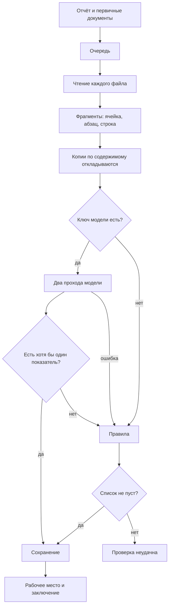

Стадии сессии:

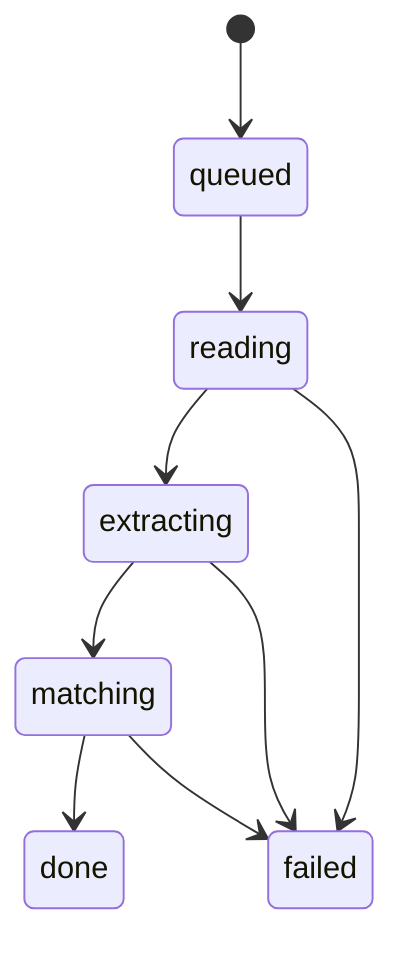

1. **Чтение.** Отчёт и каждый первичный файл читаются отдельно. Файл, который не открылся, не подменяется демонстрационными данными: ошибка остаётся на этой проверке, остальные результаты сохраняются.
2. **Извлечение.** Из книги Excel, документа Word и PDF с текстовым слоем получаются фрагменты с якорем. PNG, JPG и страница PDF без текста читаются локальным распознаванием.
3. **Выбор движка.** Непустой двухэтапный просмотр становится результатом. Правила запускаются, когда ключа нет, модель не ответила или просмотр не вернул ни одного показателя.
4. **Сохранение.** Проверки и уведомления записываются в базу. Повторный запуск с новыми документами пересчитывает комплект и не затирает старый результат, если новый проход сорвался.

Пустой список показателей не считается успешным отчётом без замечаний. Такая проверка помечается как неудачная.

Одинаковый файл, загруженный второй раз, не увеличивает суммы. Сравнение идёт по содержимому, а не только по имени.

## Два движка

Когда ключ задан и двухэтапный просмотр вернул хотя бы один показатель, эти строки становятся результатом. «Совпадает» остаётся только если значение в колонке источника разбирается как равное отчёту. Несколько разных сумм или количеств в одной цитате не сводятся к тому числу, которое равно отчёту: строка остаётся на ручную проверку. Если модель пометила, какие документы входят в расчёт, сервер оставляет те, чей договор совпадает с договором отчёта и чья дата попадает в период отчёта, складывает эти части сам и показывает формулу. Другой договор, дата вне периода и повтор файла в сумму не входят и называются в пояснении. Итог строки, в названии которого нет своей статьи, заново считается из составных итогов этой строки. Разбивка, которая в отчёте уже складывается в одну из этих статей, второй раз в итог не входит и остаётся непроверенной. Внутренняя разбивка без своего документа остаётся непроверенной. Показатель «получено», «принято» или «фактически» не закрывается голым числом из плана. Строки, которые модель не назвала, добавляются из правил со статусом ручной проверки и не помечаются как совпадение. Пустой список и ошибка модели по-прежнему целиком уходят в `ruleChecks`.

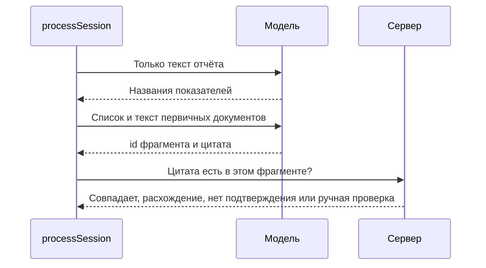

Если модель не смогла назвать показатели по отчёту, список для второго прохода берётся из правил по одному отчёту. Первичные документы на этом шаге всё равно читает модель. Слово модели «совпало» не принимается: статус ставит сервер.

Запасной проход, `ruleChecks`:

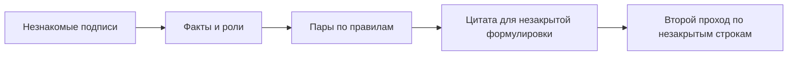

Без ключа шаги модели в этом проходе пропускаются, остаётся сверка правилами. Демонстрационная проверка модель не вызывает: её результат заранее собран и лежит в снимке.

После разбора проверяющий может выделить пропущенное слово или ячейку в отчёте. Сервер ищет только этот показатель и добавляет отдельную строку. Уже посчитанные статусы не меняются.

## Статусы и рекомендация

У каждой проверки четыре автоматических статуса. Решение человека хранится отдельно и не превращает расхождение в совпадение.

| Статус | Код | Смысл |
| --- | --- | --- |
| Совпадает | `match` | Разобранное значение отчёта равно разобранному значению источника. |
| Расхождение | `mismatch` | Оба значения разобраны, они различаются, разница посчитана как «отчёт минус источник». |
| Нет подтверждения | `not_found` | В прочитанном комплекте нет документа, который подтверждает показатель. Это не значит, что показатель ложный. |
| Ручная проверка | `needs_review` | Файлы противоречат друг другу, формулировка не разобрана или цитата модели не стала измеримым значением. |

Решение проверяющего:

| Кнопка | Код | Что меняется |
| --- | --- | --- |
| Замечание подтверждено | `confirmed` | Автоматический статус остаётся. Расхождение и отсутствие по-прежнему требуют доработки. |
| Снять замечание | `verified` | В интерфейсе это «Проверено». Строка перестаёт блокировать приёмку, числа в ней остаются. Нужен комментарий. |
| Не рассмотрено | `pending` | Решения ещё нет. |

Рекомендация смотрит на автоматический статус и только на снятое замечание:

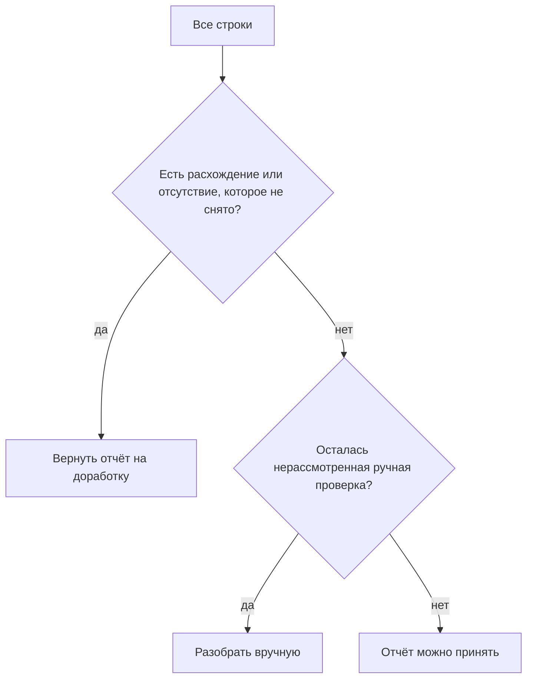

## Подсветка

Подсветка ставится только туда, где извлечение само получило координаты или якорь. Если известны только страница и цитата, показываются они. Прямоугольник по цитате не выдумывается.

На пути модели страница, рамка, якорь и подпись места копируются из фрагмента, чей `id` вернула модель. У листа Excel страница может быть нулевой: это лист, а не пропущенная рамка. Содержимое пользовательских файлов не пишется в `localStorage`.

## Правила сравнения

Эти правила считают результат, когда ключа нет или полный просмотр ничего не вернул. Те же идеи остаются в разборе цитат: роль и единица, вид документа, период, вычет возврата, разделение цены и суммы, конфликт двух значений как ручная проверка. Конкретные суммы, даты, названия и номера учебного комплекта не зашиты.

Когда ключ задан и просмотр непустой, статус ставит он: цитата должна быть в файле, разные части суммы складываются, повтор одной суммы не складывается, дата другого месяца не входит в показатель этого месяца, счёт и план не подтверждают приёмку или оплату.

### Факты

Отчёт задаёт список того, что нужно подтвердить. Первичные документы дают факты-источники. Факт — это роль, подпись, сырой текст, разобранное значение, документ и фрагмент, из которого оно взято.

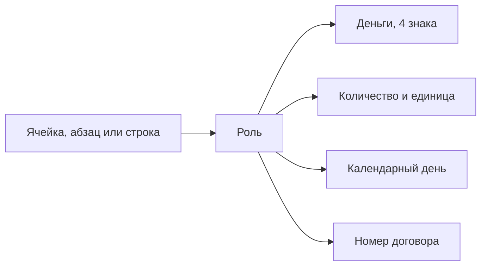

Разбор строгий:

- деньги хранятся целым числом с четырьмя знаками после запятой, без округления до копеек посередине расчёта;
- количество хранится вместе с единицей, `шт.`, `час`, `чел.`, `месяц` и их переводные формы приводятся к одному виду;
- дата приводится к календарному дню;
- номер договора сравнивается без лишних пробелов и знака номера;
- пустая формула Excel не считается нулём.

Столбцы вроде «цена» и «сумма» не складываются друг с другом. «С НДС» и «без НДС» — разные основания. Налог сам по себе не прибавляется к сумме поставки. Возврат вычитается только из показателя, который сам говорит о приёмке за вычетом возврата. Повтор одного и того же факта в одном фрагменте в сумму не входит. Общий итог документа не прибавляется к строкам, из которых он уже собран. Если по одному показателю документы называют разные суммы и это не частичные поставки, берётся более новый документ, а в пояснении перечисляются более ранние. Строка «услуги» не складывается со строками оборудования, и наоборот.

### Что с чем можно сравнивать

Код связывает показатель отчёта с источником по нескольким независимым признакам, а не по похожести двух абзацев целиком.

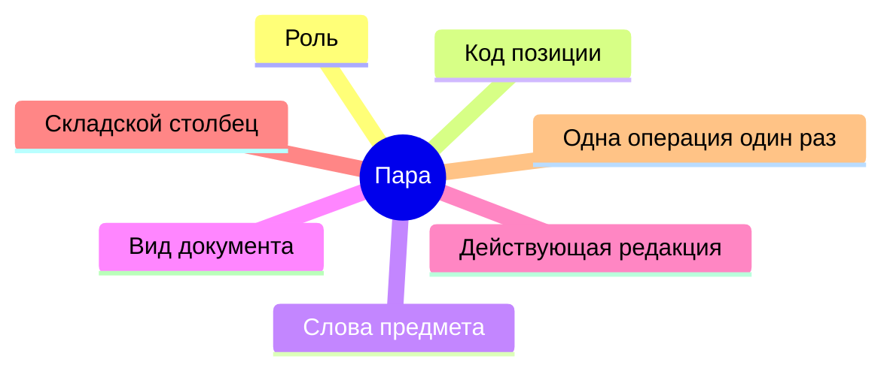

- одна роль: количество с количеством, сумма с суммой, срок поставки со сроком поставки;
- код позиции или работы, если он есть у обеих сторон;
- слова предмета: «анализатор» не подтверждается строкой «монтаж», «обучение» не подтверждается часами пусконаладки;
- вид документа: поставленное количество ищется в накладной, акте или реестре отгрузок, оплата — в платёжном документе, срок поставки — в договоре и дополнительном соглашении;
- действующее условие важнее заменённого: дополнительное соглашение, которое меняет срок или цену, перекрывает прежнюю редакцию договора;
- складской показатель «оприходовано» смотрит в столбец прихода, а не в остаток и не в сумму прихода с остатком;
- два документа с одним и тем же числом по одной операции подтверждают его один раз, а не складываются.

Если подтверждений несколько и они про разные значения, строка остаётся на ручной проверке. Если это части одной поставки, количества и суммы складываются, возврат вычитается.

Ответ «да» или «нет» не становится названием товара. Название организации обрывается там, где в тексте начинается следующая роль: заказчик, получатель, плательщик. Поэтому поставщик не склеивается с заказчиком из соседнего поля.

Отсутствие отдельного акта не закрывается упоминанием этой работы в договоре или в журнале монтажа. Для завершённого ввода нужен сам акт или протокол.

## Где участвует модель

Модель не возвращает готовый список расхождений. Такой ответ нельзя повторить, нельзя привязать к ячейке и нельзя отличить от догадки. На одной и той же паре документов она может сложить две копии одного факта, оставить старый срок рядом с новым или назвать разницу приблизительно. Поэтому статус и разницу всегда считает сервер.

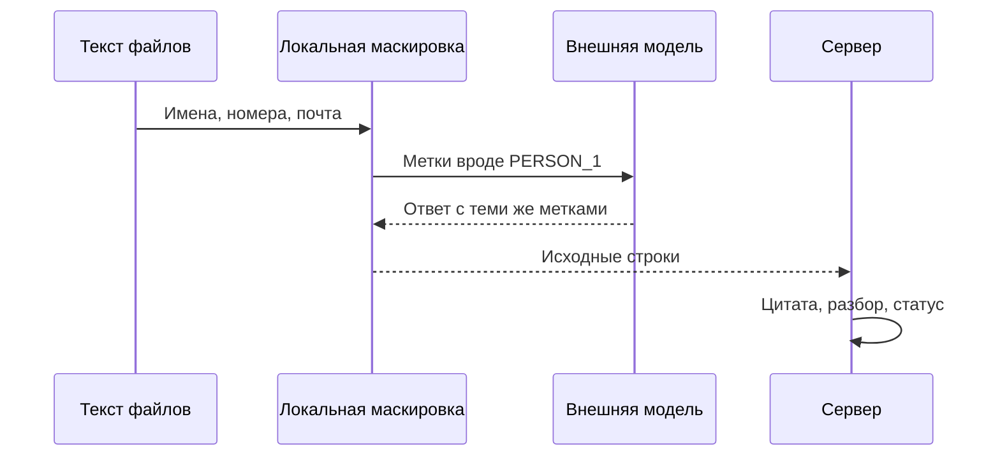

**Маскировка перед отправкой.** Весь пользовательский текст запроса проходит `scripts/privacy/mask_bridge.py`. Русский фрагмент обрабатывает pii-mask: Natasha для имён и организаций, шаблоны с контрольными суммами для ИНН, ОГРН, СНИЛС, паспорта, телефона и почты. Фрагмент не на русском обрабатывает Microsoft Presidio; почта, телефон, карта и российский ИНН проверяются в любом языке. Одинаковая нормальная форма во всём запросе получает одну метку, например `{{PERSON_1}}`. Словарь остаётся в памяти вызова и подставляется обратно в ответ до проверки цитаты. Если маскировка не запустилась, текст не отправляется. Для PDF и загруженных изображений в двухэтапный запрос прикладывается до 20 страниц. Слова, которые маскировщик заменил, закрашиваются по рамкам распознавания, и поверх краски пишется та же метка, например `{{INN_1}}`. Суммы, даты и номера договоров на картинке остаются. Если метку не удалось поставить на рамку, эта страница в запрос не входит.

**Незнакомая подпись.** Только на запасном проходе. Если словарь не знает заголовок колонки, модели отправляются подпись и короткий образец значения. Она возвращает только роль из фиксированного списка: количество, сумма, цена, перевозка, дата, номер договора, ИНН, контрагент, наименование. Значение из ответа не берётся. Если разобрать текст в этой роли не удалось, подсказка отбрасывается и строка остаётся на ручной проверке.

**Несвязанная формулировка.** Если правила поняли показатель, но оставили ручную проверку из-за формулировки, модели отправляются уже замаскированные название, значение отчёта и фрагменты. Она возвращает только идентификатор фрагмента и короткую цитату. Дальше работает `compareLinkedValues`:

1. Цитаты нет в указанном фрагменте — ответ выбрасывается, статус не меняется.
2. Обе стороны разбираются как дата, сумма или количество — сервер ставит «совпадает» или «расхождение» и пишет разницу.
3. Цитата есть, но как число, дату или количество она не читается и буквально со значением отчёта не совпадает — строка остаётся на ручной проверке, цитата показывается как кандидат.
4. Уже готовые совпадения и расхождения правил модель не пересматривает.

**Второй проход по незакрытым строкам.** После правил сервер отправляет текст прочитанных источников и только строки «нет подтверждения» и «ручная проверка», пачками по 25. Картинки не отправляются. Ответ может содержать несколько цитат одной строки: число источников и сами источники через запятую, каждый как `id | цитата`. Сервер проверяет каждую цитату и складывает суммы и количества. Число без единицы сравнивается с числом в цитате, даже если единица названа только там. Сумма без знака валюты сравнивается, когда обе стороны выглядят как деньги. Из цитаты берётся число рядом с единицей измерения, а не номер в коде вроде «БК-8». Если в строке несколько сумм, сервер берёт сумму, равную отчёту, либо последнюю. План, проект и счёт не закрывают строку о приёмке или оплате как совпадение: такая цитата остаётся на ручной проверке. Если цитата относится к строке, которую правила уже закрыли, и посчитанный по ней статус другой, в объяснение дописывается наблюдение, а статус, разница и значение источника остаются прежними.

Если модель вернула текст, который не разбирается как JSON, тот же запрос отправляется ещё один раз. Второй сломанный ответ не подменяет уже посчитанный правилами результат.

В пояснении строки прямо сказано, когда подпись или фрагмент предложила модель, а сравнение выполнил сервер. Само пояснение хранится кодом и собирается на языке интерфейса. Уже сохранённая готовая фраза, в том числе в демонстрационном снимке, показывается как записана.

### Уведомления

Уведомления тоже хранятся кодами и переводятся на все одиннадцать языков. Старая запись с готовой русской фразой показывается как есть.

| Код | Когда появляется |
| --- | --- |
| `duplicate_file` | Второй файл повторяет уже учтённый по содержимому. |
| `partial_read` | Часть подтверждающих файлов не прочитана, найденные результаты сохранены. |
| `model_two_stage` | Результат дал непустой двухэтапный просмотр. |
| `model_failed` | Просмотр сорвался, результат посчитан правилами. |
| `labels_failed` | Модель не подсказала роли незнакомых подписей. |
| `context_truncated` | В запрос вошло только начало комплекта. |
| `legacy` | Старая проверка, в которой уведомление уже было готовой фразой. |

## Лимиты запроса

Полный просмотр режет отчёт и первичные документы по отдельности. Запасной проход правил режет текст источников тем же способом, но со своим потолком. Хвост в запрос не входит. Проверка становится неполной и получает `context_truncated`, а не молчаливое «нет подтверждения» по непрочитанному хвосту.

| Проход | Знаков на сторону | Знаков на фрагмент | Переменные |
| --- | --- | --- | --- |
| Два этапа модели | 1 200 000 отчёта и 1 200 000 источников | 12 000 | `SVERKO_SCAN_CHAR_LIMIT`, `SVERKO_SCAN_FRAGMENT_SLICE` |
| Запасной проход правил | 600 000 | 6 000 | `SVERKO_PACK_CHAR_LIMIT`, `SVERKO_PACK_FRAGMENT_SLICE` |

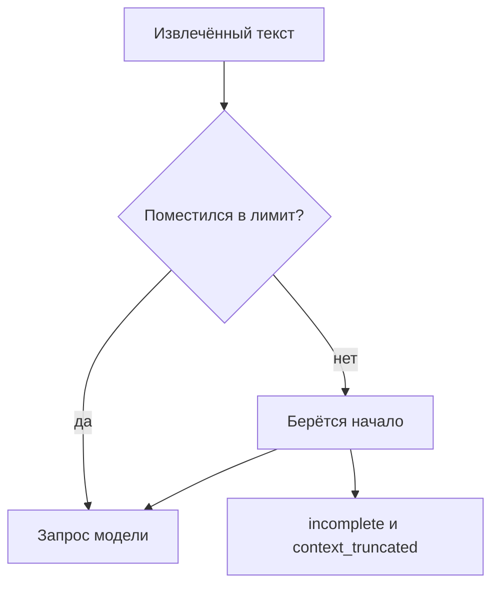

## Документы

| Формат | Как читается |
| --- | --- |
| XLSX | Листы, заголовки, строки показателей «показатель / значение / единица», обычные таблицы. Ширина колонок сохраняется для просмотра. Формула без сохранённого результата не заменяется нулём. |
| DOCX | Абзацы и таблицы. |
| PDF | Страница рисуется и распознаётся локально, в том числе когда текстовый слой есть, но он не совпадает с рисунком. Текстовый слой берётся только если распознавание не вернуло ни одной строки. В предпросмотре открывается исходный файл: страница рисуется заново под экран и масштаб, а не растягивается из мелкой копии на ширину колонки. |
| PNG, JPG | Локальное распознавание. Координаты подсветки появляются только если распознаватель их вернул. В предпросмотре показывается сам файл, один пиксель файла на пиксель экрана. |

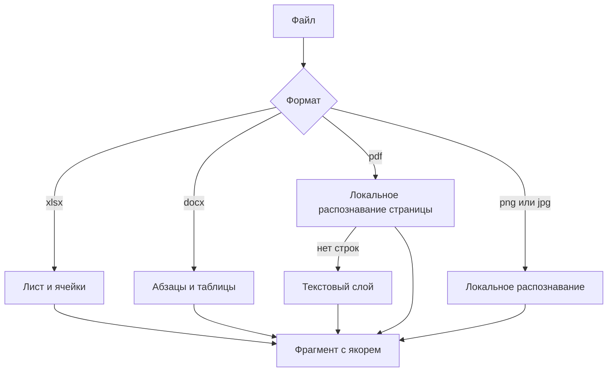

Тип документа определяется по имени и началу текста: договор, дополнительное соглашение, накладная, акт, счёт, платёж, журнал, реестр, склад. Имя можно оставить на русском, даже если текст переведён: так вид документа не теряется.

Демонстрационные файлы лежат в `public/demo/lab/`. Русский комплект — в корне этой папки, переводы — в подпапках языков. Имена файлов общие. Снимок уже посчитанной проверки для каждого языка — `src/mocks/demo-locales/`. Русский снимок — `src/mocks/realisticDemo.ts`. Страницы берут демо только через `src/services/auditService.ts`.

Учебный комплект КП-47/2026 для регрессии лежит в `Sverko_1_QA_2026-11-09/`: отчёт и шесть первичных документов. Ожидание этой проверки — 7 совпадений, 4 расхождения и одно отсутствие подтверждения. Ответы в `expected.json` в алгоритм не входят. Контрактный тест прогоняет комплект через `processSession`: и без ключа, и с пустым ответом модели получается тот же счёт. Непустой ответ модели с настоящей цитатой заменяет правила.

## Интерфейс

Маршруты тонкие и лежат в `src/routes`. Страницы — в `src/pages`.

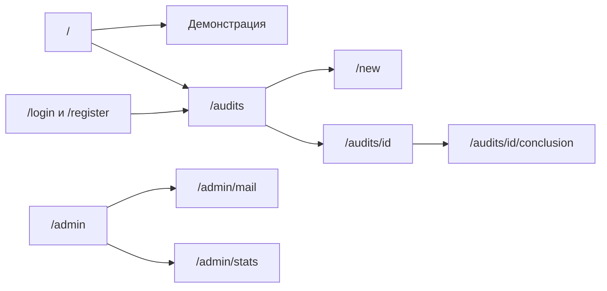

- Главная: короткий верхний ряд и вход в демо.
- Список проверок и создание новой. Если список не загрузился, ошибка остаётся на экране, демонстрационные сессии к нему не подмешиваются.
- Рабочее место: слева показатели, справа документ с подсветкой. На узком экране панели переключаются. Рядом лежат сравнение, выбор фрагмента и дозагрузка файлов, каждый в своём компоненте.
- Заключение: сводка, таблица замечаний, текст для передачи, решение человека, выгрузка реестра замечаний в Excel.

На главной панель компактная. В рабочем месте остаётся узкая полоса значков, чтобы место занимало доказательство.

В рабочем месте у показателя, который ещё не совпал, показана подсказка, какое значение записать в отчёт. Записанное число сравнивается с уже найденным источником и меняет статус строки. Исходный файл скачивается как был. Для отчёта Excel отдельная ссылка собирает книгу с записанными правками.

Заключение можно скопировать и напечатать средствами браузера.

## Данные и доступ

Локально, если не задан `DATABASE_URL`, сессии лежат в SQLite в каталоге `.data/`. С `DATABASE_URL` используется PostgreSQL. `sslmode=require` шифрует соединение и принимает сертификат хостинга. `sslmode=verify-full` и адрес с `PGSSLROOTCERT` или `sslrootcert` проверяют сертификат. Оригиналы файлов хранятся на сервере и переживают перезапуск.

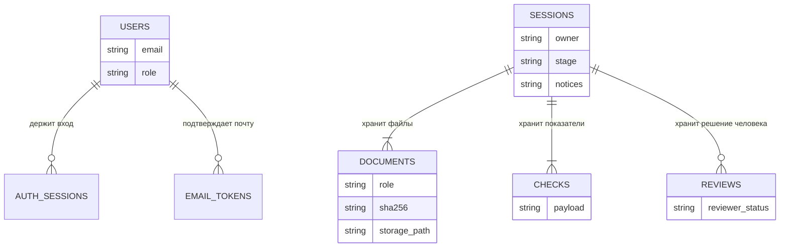

Решение человека лежит в `reviews` и не переписывает автоматический статус внутри `checks`.

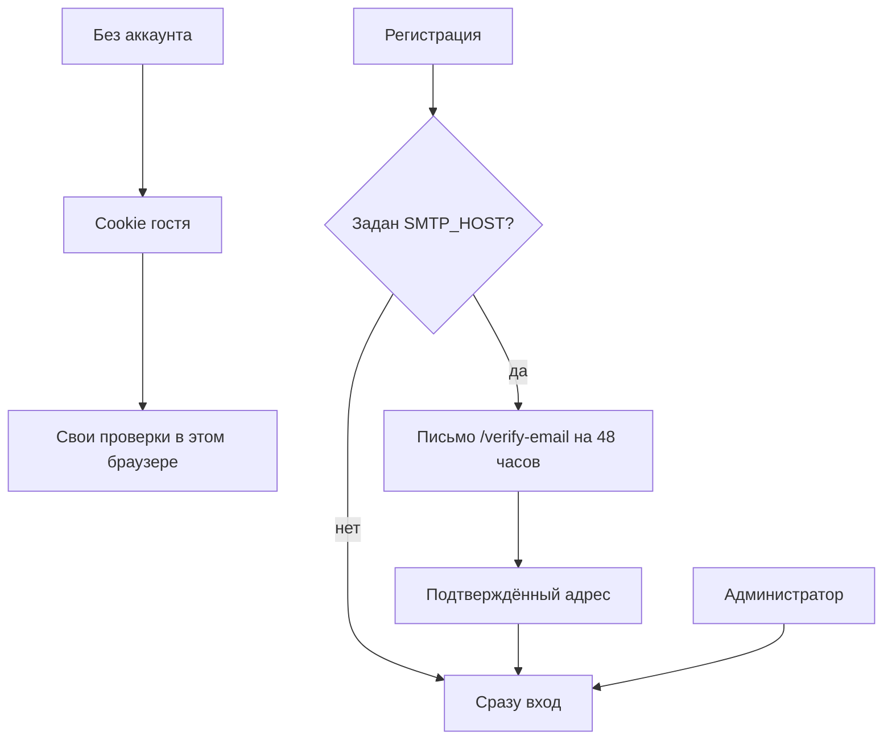

Первый администратор создаётся при старте из `ADMIN_EMAIL` и `ADMIN_PASSWORD`, если такого адреса ещё нет. Пароль в репозиторий не кладётся. Администратор входит без письма и видит все проверки. Пользователь видит только свои.

Если заданы `SMTP_HOST`, `SMTP_USER` и `SMTP_PASS`, регистрация не открывает сессию сразу. Сервер создаёт аккаунт, пишет одноразовый токен и отправляет письмо. Пока адрес не подтверждён, вход с этой почты отклоняется. Для почты Timeweb это `smtp.timeweb.ru`, порт `465`, `SMTP_SECURE=true`. Логин — полный адрес ящика, и письмо уходит от того же адреса. Тот же ящик сервер читает по IMAP: по умолчанию `imap.timeweb.ru`, порт `993`. Администратор видит входящие в разделе «Почта»: отправитель, тема, дата и текст. Сводка по аккаунтам, проверкам и показателям — в разделе «Статистика». Пароль ящика в репозиторий не кладётся. Без `SMTP_HOST` (тесты и локальный запуск) аккаунт создаётся и сразу входит. Если письмо не ушло, аккаунт не сохраняется.

Ключ модели тоже только на сервере: `AI_API_KEY` и `AI_BASE_URL` либо `LOVABLE_API_KEY`. В код браузера ключ не попадает. Демонстрация без ключа работает.

## Устройство репозитория

Клиент не импортирует `src/server/**`. Смена схемы базы делается отдельно от этого репозитория: каталоги `supabase/migrations/` и `drizzle/` руками не правятся.

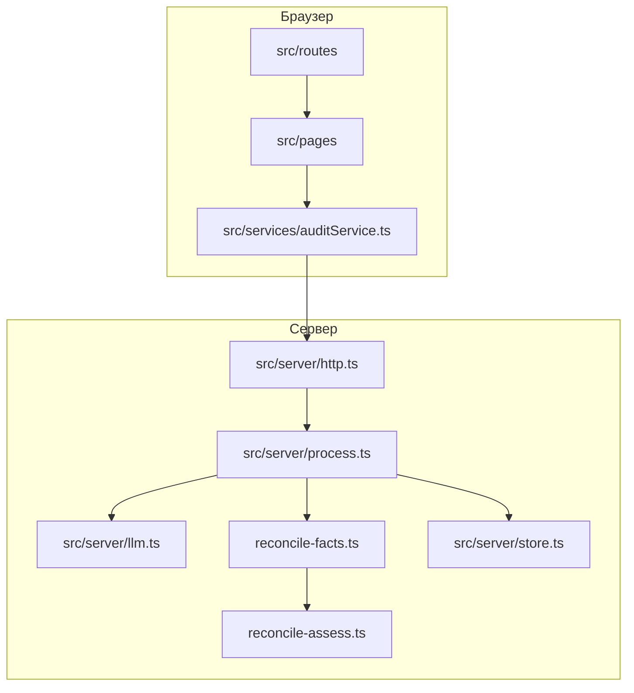

| Каталог | Роль |
| --- | --- |
| `src/routes` | Тонкие маршруты |
| `src/pages` | Экраны |
| `src/components` | Интерфейс и просмотр документа |
| `src/services` | Единственный вход страниц к проверкам |
| `src/types` | `AuditSession`, `CheckResult`, `EvidenceReference` |
| `src/server` | Чтение файлов, сверка, модель, хранение |
| `src/server/http` | Вход, админка, проверки, общие ответы |
| `src/server/llm` | Запрос к модели и лимиты текста |
| `src/mocks` | Демонстрационные снимки |
| `src/i18n` | Тексты интерфейса и языки адреса |
| `src/lib` | Заключение, коды уведомлений и пояснений |
| `src/test` | Vitest |
| `public/demo/lab` | Файлы демонстрационного комплекта |

Стек: TanStack Start, React 19, Vite, TypeScript, Tailwind, shadcn/ui, Lucide.

## Тесты и поставка

`bun run test` гоняет правила сверки без сети. Подготовка тестов очищает `SMTP_HOST` и `AI_API_KEY`, даже если они есть в локальном `.env`, поэтому регистрация в тестах сразу открывает сессию, а модель не вызывается. Живой ключ остаётся только при `SVERKO_LIVE_AI=1`. Обычный прогон также обнуляет `DATABASE_URL`: PostgreSQL продакшена в него не входит. Вместо этого поднимается встроенный совместимый движок. `SVERKO_TEST_POSTGRES=1` и команда `bun run test:pg` оставляют живой адрес.

Тот же прогон вызывает заглушку маскировки `scripts/privacy/stub_bridge.py` через локальный Python: письмо и длинный номер заменяются меткой и возвращаются обратно. Полный мост pii-mask / Presidio проверяется, когда собрано `third_party/.venv`.

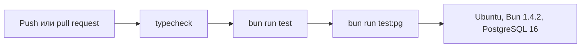

GitHub Actions на каждый push и pull request запускает эту цепочку. Для фикстур и заглушки на раннере ставятся Liberation Sans и Python. Команда `docker build -t sverko .` тоже гоняет typecheck и тесты. `RUN_TESTS=0` и Compose этот шаг пропускают, чтобы контейнер быстрее открылся. Живой PostgreSQL в сборку образа не входит: его поднимает `docker compose up`. Синтетические PDF берут Arial или Segoe UI в Windows и Liberation Sans или DejaVu на Linux.

Отдельно проверяются:

- частичные поставки и повтор одного файла;
- цена, которая не прибавляется к сумме строки;
- незнакомая подпись: без модели остаётся ручная проверка, с названной ролью разницу считает код;
- цитата модели: настоящая цитата даёт расхождение с посчитанной разницей, выдуманная цитата статус не меняет, уже совпавшая строка не переоткрывается;
- второй проход по комплекту: цитата закрывает только «нет подтверждения» и «ручную проверку»; несколько подтверждённых цитат складываются; для уже посчитанной строки в объяснение может добавиться наблюдение, статус не меняется;
- комплект КП-47/2026 через `processSession`: семь совпадений, четыре расхождения, одно отсутствие подтверждения и без ключа, и при пустом ответе модели.

Живой вызов модели в обычный прогон не входит. Его включает `SVERKO_LIVE_AI=1`, и для этого нужен ключ в окружении.

## План развития

Сверка уже читает Excel, Word, PDF с текстовым слоем и локально распознаёт скан. Статус считает сервер, а пояснение строки переводится на язык интерфейса. Дальше имеет смысл только то, что помогает проверяющему отличить ошибку отчёта от нехватки данных. Юридическую приёмку сервис не забирает на себя.

1. **Тип несоответствия.** Рядом со статусом появится код: сумма, количество, период, пропуск документа, дубль, чужая связь. Заключение и выгрузка покажут этот тип. Автоматический статус от кода не меняется: расхождение остаётся расхождением, отсутствие — отсутствием.
2. **Плохой скан.** Если страница не прочитана, строка не должна выглядеть так, будто комплект прочитан и подтверждения нет. Уведомление отделит «не прочитано» от «прочитано и не найдено». Полноты на смазанном скане по-прежнему не обещаем: такая строка остаётся человеку.
3. **Нестандартный бланк.** Новая форма не должна требовать отдельного словаря колонок. Связь пойдёт от якоря, цитаты и реквизитов, которые извлечение уже получило. Подпись, которой словарь не знает, без ключа модели остаётся на ручной проверке.
4. **Что остаётся человеку.** Два одинаково подходящих документа не усредняются. Снятое замечание не превращает расхождение в совпадение. Показатель без источника не объявляется ложью отчёта.

Порядок такой: сначала тип несоответствия, потому что он ничего не меняет в расчёте и сразу виден в заключении. Затем разделение непрочитанного скана и настоящего отсутствия. Нестандартные бланки — после этого, на уже накопленных комплектах, а не на одном учебном наборе.

## Границы

Сверка не обещает полноту на скане плохого качества и не заменяет проверяющего. Несколько одинаково подходящих документов остаются на ручной проверке, а не усредняются. Показатель без источника не объявляется ошибкой отчёта. Демонстрационный снимок — это готовый пример, а не новый запуск обработки загруженных пользователем файлов.
